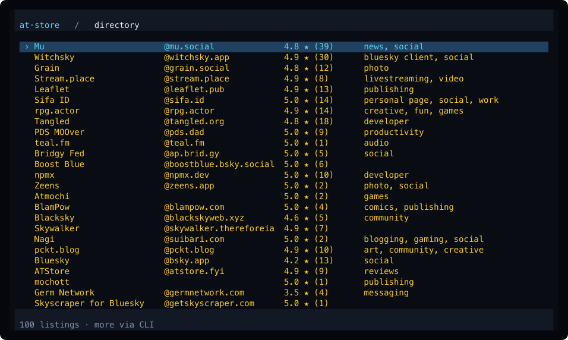

# atstore-terminal

A CLI and full-screen TUI for [at-store](https://atstore.fyi/en/about), the open directory of Atmosphere apps.



Listings are public `fyi.atstore.listing.detail` records on their makers' PDSes. This tool talks to the public [XRPC API](https://atstore.fyi/developers/atproto) — no account needed to browse — and can optionally publish a review to your own PDS.

Built with [bomb.sh](https://bomb.sh): `@bomb.sh/router` for typed command routing, `@bomb.sh/args` for the TUI command bar, `@bomb.sh/tty` for the full-screen renderer, and `@clack/prompts` for the guided prompts.

## Install

```sh
npm install
npm run build
npm link        # makes `atstore` available on your PATH
```

Requires Node.js 22 or newer. Set `ATSTORE_URL` to point at a different ATStore deployment (defaults to `https://atstore.fyi`).

## Usage

```sh
atstore                         # guided prompts (Clack)
atstore tui                     # full-screen browser
atstore tui "bluesky client"     # open with a query

atstore search "bluesky client" --sort rating --tag social
atstore list --data app.bsky --has open-source --limit 50
atstore show @mu.social --reviews
atstore reviews "Witchsky" --all
atstore tags --pages 4
atstore describe

atstore login you.bsky.social     # OAuth via your own PDS
atstore whoami                    # inspect the stored session
atstore logout                    # revoke and remove it

atstore --json search "mu" --limit 5   # machine-readable output
```

### Reviewing a listing

`atstore review` builds the `fyi.atstore.listing.review` record described in the [developer docs](https://atstore.fyi/developers/atproto). Without `--post` it prints the record as JSON so you can inspect or publish it yourself.

To publish it to your own PDS, sign in once with OAuth. This works with `bsky.social` and self-hosted PDSes because the handle's DID document is used to discover its authorisation server:

```sh
atstore login you.example
# your browser opens the PDS authorisation page, then redirects to a loopback port

atstore review @mu.social --rating 5 --text "Lovely client" --post
```

The CLI requests the app-password-equivalent `atproto transition:generic` scope, stores refresh tokens and DPoP keys in your OS config directory with `0600` permissions, and refreshes access tokens as needed. Set `ATSTORE_CONFIG_DIR` to keep that file somewhere else. No token is placed in argv or committed to the repo.

App passwords remain available as a fallback:

```sh
export ATPROTO_IDENTIFIER=you.example
export ATPROTO_APP_PASSWORD=xxxx-xxxx-xxxx-xxxx
# optional, defaults to https://bsky.social
export ATPROTO_PDS=https://your-pds.example

atstore review @mu.social --rating 5 --text "Lovely client" --post
```

`review --post` prefers a stored OAuth session and only falls back to those environment variables when no session exists. The tool creates the required `fyi.atstore.profile` record at rkey `self` if it does not exist.

## TUI keys

| Key                    | Action                                                         |
| ---------------------- | -------------------------------------------------------------- |
| `↑` / `↓` or `j` / `k` | Move through listings or scroll details                        |
| `enter`                | Open the selected listing                                      |
| `r`                    | Toggle reviews                                                 |
| `/` or `s`             | Search; flags work, e.g. `/bluesky --tag social --sort rating` |
| `o`                    | Open the listing in your browser                               |
| `esc`                  | Go back                                                        |
| `q` / `ctrl-c`         | Quit                                                           |

## API

The client uses these public endpoints:

| NSID                                   | Use                     |
| -------------------------------------- | ----------------------- |
| `fyi.atstore.server.describe`          | Capabilities and limits |
| `fyi.atstore.directory.searchListings` | Search and filters      |
| `fyi.atstore.directory.getListing`     | Listing detail          |
| `fyi.atstore.reviews.listForListing`   | Reviews                 |

The current deployment returns the listing card under `listing` and detail fields (URL, description, links, timestamps) at the response root. `ATStoreClient.getListing()` merges both the current and older response shapes.

## Development

```sh
npm run format:check
npm run check
npm test
npm run build
npm run dev -- search mu        # run TypeScript directly
```

Layout:

- `src/cli.ts` — thin executable entrypoint
- `src/cli/` — router, schemas, handlers, output and listing resolution
- `src/client/` — XRPC client, request building and response normalisation
- `src/directory/` — shared directory helpers such as tag counts
- `src/format/` — terminal width, tables and detail rendering
- `src/interactive/` — Clack guided flows
- `src/oauth/` — loopback OAuth login, secure token storage and session restore
- `src/review/` — review records, auth selection and PDS publishing
- `src/tui/` — `@bomb.sh/tty` frame, input parsing and session
- `src/types/` — API types grouped by domain
- `src/test/` — compiled Node tests

## Support

Open an issue in this repository with the command you ran, your Node version, and the full error. Please do not include app passwords or tokens.

## Trademark

ATStore and the at·store wordmark belong to the Atproto Community Collective. This is an independent client and is not affiliated with or endorsed by the directory.

## Licence

AGPL-3.0. See [LICENSE](./LICENSE).

## Credits

ATStore is built by [Andrew Lisowski](https://github.com/hipstersmoothie) and maintained by the [AT Protocol Community](https://discourse.atprotocol.community).
